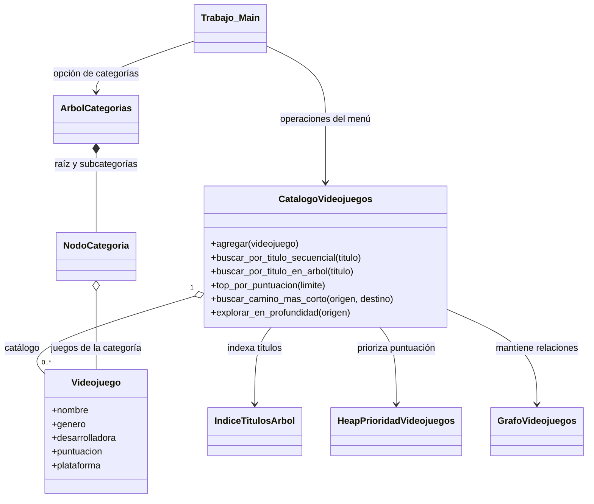
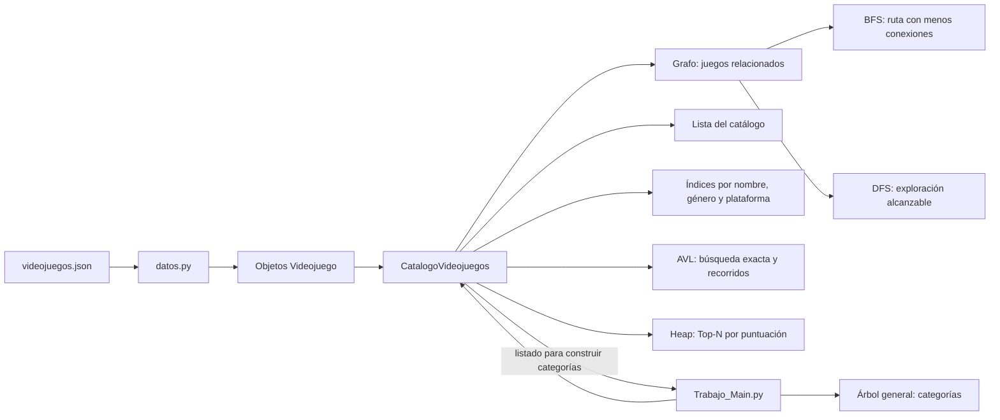

# Trabajo práctico integrador — Catálogo de videojuegos

Sistema de terminal para guardar, buscar, explorar, relacionar y recomendar videojuegos. El proyecto aplica clases, estructuras de datos y algoritmos vistos en la materia a consultas concretas sobre un catálogo.

## Integrantes

- Máximo Barraza
- Gabriel Ávila
- Tomás Tagliani

## Entregas realizadas

### TP 1 — Objetos y clases

- Modela cada videojuego con la clase `Videojuego` y sus datos principales.
- Separa el modelo, la carga del archivo JSON, la lógica del catálogo y la interfaz de terminal.
- Permite listar y buscar juegos, además de filtrarlos por género y plataforma.

### TP 2 — Análisis de algoritmos

- Compara la búsqueda exacta de títulos mediante recorrido secuencial y búsqueda en árbol.
- Permite elegir la estrategia desde la interfaz y medir su rendimiento.
- Incluye `experimento_tp2.py` para mediciones reproducibles con 1.000, 10.000 y 100.000 elementos, y el [análisis completo](ANALISIS_TP2.md) con resultados y complejidades.

### TP 3 — Árbol binario de búsqueda

- Incorpora un índice de títulos para acelerar la búsqueda exacta y conservar títulos duplicados.
- Permite comparar la búsqueda secuencial con la búsqueda en el árbol.
- Ofrece recorridos inorden, preorden y postorden desde el menú.
- Incluye el [análisis del árbol](ANALISIS_TP3.md) y pruebas en `test_tp3.py`.

### TP 4 — Árbol desbalanceado y AVL

- Analiza el efecto de insertar datos en un árbol binario de búsqueda sin balancear.
- Implementa balanceo AVL en el índice de títulos para mantener acotada la altura.
- Actualiza alturas y realiza rotaciones cuando una inserción desbalancea el árbol; incluye pruebas en `test_tp4.py`.

### TP 5 — Árbol general de categorías

- Representa géneros y categorías como un árbol general, cuyos nodos pueden tener varios hijos.
- Organiza los videojuegos por género y muestra las cantidades asociadas a las categorías y sus descendientes.
- La exploración está disponible desde la opción 5 del menú.

### TP 6 — Heap de prioridades

- Implementa manualmente un heap binario máximo que prioriza videojuegos por puntuación.
- Conserva el orden de inserción cuando hay empates.
- La opción 6 consulta un Top-N mediante una copia del heap, sin modificar el ranking guardado.

### TP 7 — Grafo de videojuegos

- Modela cada videojuego como un vértice y crea una arista no dirigida cuando dos juegos comparten género o desarrolladora.
- Asigna a cada relación un puntaje de similitud: suma género, desarrolladora y plataformas compartidas.
- Permite consultar los juegos relacionados ordenados por ese puntaje.

### TP 8 — Recorridos BFS y DFS

- Implementa BFS con una cola para encontrar un camino con la menor cantidad de conexiones entre dos videojuegos.
- Implementa DFS con una pila para explorar los videojuegos alcanzables desde un origen.
- Ambos recorridos tienen complejidad O(V + E), con V vértices y E aristas.
- Las opciones 10 y 11 del menú ejecutan BFS y DFS, respectivamente.

### TP 9 — Caminos mínimos

- Esta entrega fue salteada por decisión de la cátedra.
- El BFS implementado minimiza la cantidad de aristas, no el puntaje acumulado de similitud; el sistema no presenta ese puntaje como costo de un camino mínimo.

### TP 10 — Integración del producto

- Reúne las búsquedas, filtros, estructuras de categorías, ranking y consultas del grafo en una interfaz de terminal.
- El producto se ejecuta desde `Trabajo_Main.py`; la defensa y sus notas de preparación se entregan por separado.

## Ejecución

Se requiere Python 3.8 o posterior. No hacen falta paquetes externos.

```bash
python Trabajo_Main.py
```

Para ejecutar el experimento del TP 2:

```bash
python experimento_tp2.py
```

Para ejecutar las pruebas automatizadas:

```bash
python -m unittest discover -v
```

## Archivos principales

- `Trabajo_Main.py`: menú e interacción por terminal.
- `videojuego.py`: modelo del dominio.
- `catalogo.py`: colección, índices y operaciones del catálogo.
- `datos.py` y `datos/videojuegos.json`: carga y datos de ejemplo.
- `busquedas.py`: búsqueda secuencial e índice AVL de títulos.
- `arbol_general.py`: árbol general de categorías.
- `heap_prioridad.py`: heap máximo para el ranking.
- `grafo_videojuegos.py`: grafo, relaciones, BFS y DFS.
- `experimento_tp2.py`, `ANALISIS_TP2.md`, `ANALISIS_TP3.md`: experimento y análisis.
- `test_tp2.py`, `test_tp3.py`, `test_tp4.py`, `test_heap_prioridad.py`, `test_grafo_videojuegos.py`: pruebas automatizadas.

## Documentación complementaria

- [Objetivos del proyecto](Objetivos.txt)
- [Diagrama UML](UML%20Tp%20Estructura%20de%20Datos.png)

## Requisitos y casos de uso

### Requisitos funcionales

- Cargar videojuegos desde `datos/videojuegos.json` y representar cada registro como un objeto `Videojuego`.
- Listar el catálogo y buscar títulos exactos con estrategia secuencial o con el índice AVL.
- Filtrar videojuegos por género o plataforma y explorar la jerarquía de categorías.
- Consultar un Top-N por puntuación y ver juegos relacionados por similitud.
- Encontrar con BFS una ruta de menor cantidad de conexiones y explorar con DFS los juegos alcanzables.

### Requisitos de uso y calidad

- Ejecutarse desde terminal con Python 3.8 o posterior y sin dependencias externas.
- Mantener separados el modelo, la carga de datos, el catálogo, las estructuras y la interfaz.
- Permitir comparar estrategias y ejecutar pruebas automatizadas reproducibles.
- Informar claramente que BFS minimiza cantidad de conexiones, no el puntaje de similitud. TP9 fue salteado por decisión de la cátedra.

### Casos de uso

| Caso | Entrada | Resultado |
| --- | --- | --- |
| Listar catálogo | Opción 1 | Muestra los videojuegos cargados. |
| Buscar título | Título y estrategia secuencial o AVL | Muestra las coincidencias exactas. |
| Comparar búsquedas | Título a medir | Informa tiempos y si ambas estrategias coinciden. |
| Filtrar catálogo | Género o plataforma | Muestra los juegos que cumplen el filtro. |
| Explorar categorías | Opción 5 | Muestra categorías y cantidad de juegos. |
| Consultar ranking | Cantidad para el Top-N | Muestra los juegos con mayor puntuación sin alterar el heap original. |
| Ver juegos relacionados | Título de un videojuego | Ordena sus vecinos por similitud. |
| Buscar ruta | Títulos de origen y destino | BFS devuelve una ruta con menos conexiones, si existe. |
| Explorar red | Título de origen | DFS muestra los juegos alcanzables desde ese videojuego. |

## Diagramas del sistema

### Diagrama de clases



### Conexión entre estructuras y operaciones



## Seguimiento y metodología

El trabajo se organizó por entregas incrementales: cada etapa sumó una necesidad al catálogo y reutilizó el producto existente. El estado integrado en `main` es:

| Etapa | Estado | Evidencia principal |
| --- | --- | --- |
| TP0 — Idea, requisitos y boceto | Realizado | `Objetivos.txt` y base del catálogo. |
| TP1 a TP8 | Realizados e integrados | Secciones de entregas, módulos y pruebas descritos en este README. |
| TP9 — Caminos mínimos | Salteado por decisión de la cátedra | BFS resuelve menor cantidad de aristas, no caminos ponderados. |
| TP10 — Integración y defensa | Integrado | Menú funcional y estructuras conectadas en `main`. |

Las ramas `main` y `tp8-v1` están sincronizadas. Las notas privadas para preparar la defensa no forman parte de este repositorio.

